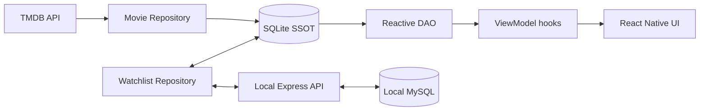

# Movie Tracker — локальний мобільний трекер фільмів

Навчальний production-oriented проєкт для шести лабораторних робіт з Android-розробки, переосмислений на **React Native + Expo + TypeScript**. Мобільний застосунок працює offline-first, Express API і MySQL запускаються виключно локально. Єдині зовнішні адреси — TMDB REST API та CDN зображень.

## Можливості

- локальний вхід за ім’ям та реактивна історія останніх входів;
- популярні фільми TMDB, пошук, pull-to-refresh і нескінченна пагінація;
- кеш SQLite як єдине джерело істини;
- локальний список перегляду з фоновою чергою синхронізації до MySQL;
- безпечне зберігання TMDB/session токенів у SecureStore;
- світла й темна Material-3-like тема, доступні контролі, кешовані постери;
- періодична перевірка прем’єр і локальні Android-сповіщення;
- типобезпечна навігація, MVVM, Jest-тести репозиторіїв та ViewModel.

## Технології

| Частина | Технології |
|---|---|
| Mobile | Expo SDK 55, React Native, TypeScript strict, Expo Router |
| Дані | expo-sqlite, expo-secure-store, власні реактивні DAO |
| Фон | expo-background-task, expo-task-manager, expo-notifications |
| Backend | Node.js 20+, Express 5, Zod, mysql2/promise |
| Database | локальний MySQL 8 |
| Tests | Jest, jest-expo, Testing Library React Native |

## Архітектура

Екран ніколи не читає мережу напряму. Репозиторій спочатку змінює SQLite, DAO сповіщає ViewModel, а ViewModel формує `UiState`. При недоступному локальному сервері операція watchlist залишається в `sync_queue` і повторюється згодом.



Шари: **Screen (View) → ViewModel hook → Repository → DAO/remote data source**. Доменні `Movie` не залежать від DTO. `MovieDto` перетворюється функцією `movieDtoToEntity`. `UiState<T>` є discriminated union: `loading | success | error`.

## Локальний запуск

### 1. MySQL і backend

1. Встановіть MySQL 8, створіть локального користувача та пароль.
2. Налаштуйте сервер:

```bash
cd server
# Windows: copy .env.example .env
# macOS/Linux:
cp .env.example .env
npm install
npm run migrate
npm run dev
```

`migrate` створює базу `movie_tracker` і всі таблиці. Перевірте `http://localhost:3000/health` — відповідь має бути `{"status":"ok"}`.

### 2. Android і mobile

```bash
cd mobile
npm install
# Windows: copy .env.example .env
# macOS/Linux:
cp .env.example .env
```

Переконайтеся, що `mobile/.env` містить:

```dotenv
EXPO_PUBLIC_API_URL=http://10.0.2.2:3000
```

Запустіть Android Emulator (AVD) в Android Studio, потім:

```bash
npx expo run:android
```

Development build потрібен для коректної перевірки фонових задач і сповіщень. Для швидкої роботи лише з UI можна використати:

```bash
npx expo start --android
```

У застосунку відкрийте **Налаштування → TMDB Bearer token**, вставте Read Access Token з налаштувань TMDB API та натисніть **Зберегти**. Це не API key v3, а Bearer token (API Read Access Token).

## Команди

```bash
# Backend
cd server
npm install
npm run migrate
npm run typecheck
npm run build
npm run dev

# Mobile
cd mobile
npm install
npm run typecheck
npm test
npx expo run:android
```

Під час додавання/оновлення Expo-залежностей використовуйте `npx expo install <package>` або `npx expo install --fix`, щоб Expo вибрав сумісні версії.

## Структура

```text
.
├── Rules.md
├── README.md
├── docs/labs/                 # LAB1.md … LAB6.md
├── mobile/
│   ├── app.json
│   ├── src/app/               # Expo Router screens
│   ├── src/components/
│   ├── src/data/
│   │   ├── local/             # SQLite, migrations, DAO
│   │   ├── remote/            # TMDB/backend clients and DTO
│   │   └── repository/
│   ├── src/domain/
│   ├── src/navigation/
│   ├── src/theme/
│   ├── src/utils/
│   ├── src/viewmodels/
│   └── __tests__/
└── server/
    ├── sql/schema.sql
    ├── scripts/migrate.ts
    └── src/                   # Express app, routes, middleware
```

## Тестування

```bash
cd mobile
npm test
```

Тести перевіряють DTO mapping, успішний/невдалий sync без втрати кешу, номер наступної сторінки та кінець списку, local-first add/remove і чергу повтору watchlist, переходи ViewModel `Loading → Success/Error`, `loadMore`, SecureStore keys і розрахунок повних/половинних зірок.

## Усунення проблем

- **Емулятор не бачить backend.** Не використовуйте `localhost` у застосунку: для стандартного Android Emulator host — `10.0.2.2`. Перевірте `/health`, firewall і порт 3000. Для фізичного пристрою задайте LAN IP комп’ютера в `EXPO_PUBLIC_API_URL`.
- **MySQL authentication plugin error.** Створіть окремого користувача з підтримуваним драйвером. Для старих інсталяцій може знадобитися `mysql_native_password`; у MySQL 8 зазвичай працює стандартний `caching_sha2_password`. Перевірте `DB_USER`, `DB_PASSWORD` та права на створення БД.
- **Android блокує cleartext HTTP.** `expo-build-properties` уже задає `usesCleartextTraffic: true`. Після зміни `app.json` перебудуйте native app через `npx expo run:android`.
- **Немає сповіщень.** Надайте дозвіл `POST_NOTIFICATIONS` на Android 13+, не вимикайте канал «Нові релізи» та перевіряйте у development build, а не в Expo Go. ОС сама планує періодичний запуск; точний час не гарантується.
- **TMDB 401.** Вставте актуальний **API Read Access Token** без префікса `Bearer`; застосунок додає префікс сам. Переконайтеся, що немає пробілів.
- **Зміни `.env` не застосувалися.** Зупиніть Metro, очистіть кеш командою `npx expo start -c` і перебудуйте застосунок.

## Конфіденційність

Проєкт не містить аналітики, BaaS, CMS, cloud auth або hosted database. `.env` виключено з Git. TMDB token і session token не записуються до SQLite чи логів.
